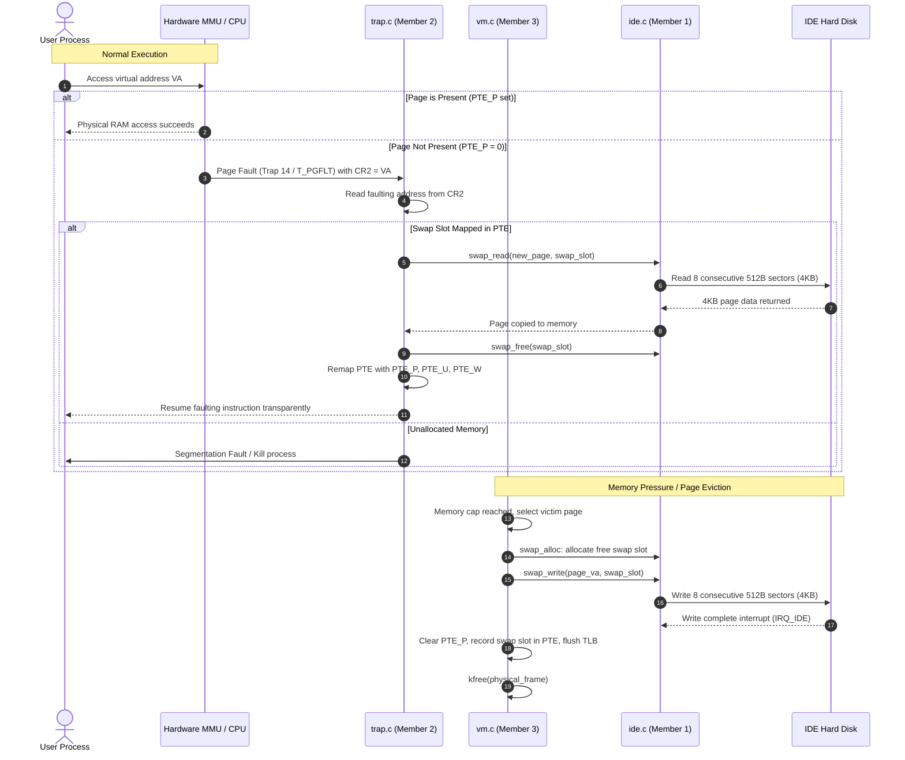

# xv6-VMM: Virtual Memory Management with Demand Paging & Disk Swap

An educational extension to the MIT xv6 Unix-like operating system implementing **demand paging with disk-backed virtual memory swap**, page fault handling, and memory capping.

---

## 👥 Team Members & Workload Distribution

| Team Member | Role | Primary Files Modified | Module Responsibility |
|---|---|---|---|
| **Mayur Rajesh Keni** | **Disk & Swap Subsystem** | `param.h`, `fs.h`, `ide.c`, `mkfs.c`, `defs.h`, `swaptest.c`, `syscall.*` | Defines swap boundaries; builds slot allocation tracking (`struct swap_entry`); translates 4KB page requests to 8 consecutive 512-byte sector I/O; implements `swap_write` & `swap_read`. |
| **Hari-Prannav** | **Page Fault Handler** | `trap.c`, `vm.c` | Intercepts `T_PGFLT` (trap 14); extracts faulting address from `%cr2`; detects swapped-out PTEs; invokes `swap_read` to restore pages into physical frames; updates page tables. |
| **Nitin-YK** | **Eviction Policy & Memory Capping** | `vm.c`, `proc.h`, `kalloc.c` | Tracks per-process memory limits; executes page replacement policy (FIFO/Clock/LRU); invokes `swap_write` to swap victim pages to disk; clears present bits and flushes TLB. |

---

## 🏗️ System Architecture & Workflow

### 1. Demand Paging Lifecycle


### 2. On-Disk Layout
The xv6 file system data occupies sectors `0` through `FSSIZE - 1` (1000 blocks). The swap partition is placed strictly **after** all file system blocks to eliminate any risk of file system corruption.

```
+-----------------------------------------------------------------------------------------------+
|                                 IDE Disk 1 (`fs.img` ~4.5 MB)                                 |
+-------------------------------------------------------------------+---------------------------+
|                          File System Data                         |        Swap Space         |
|                          (Blocks 0 .. 999)                        |   (Blocks 1000 .. 9191)   |
+------------+-------------+---------+--------------+--------+------+-------------+-------------+
| Boot Block | Super Block | Log Area| Inode Blocks | Bitmap | Data | Swap Slot 0 | Swap Slot 1 | ... (1024 slots)
|  Sector 0  |  Sector 1   | 30 blks |   26 blks    | 1 blk  | blks |  8 sectors  |  8 sectors  |
+------------+-------------+---------+--------------+--------+------+-------------+-------------+
                                                                    ^
                                                          SWAP_START = 1000
                                                    (FSSIZE disk sector offset)
```

---

## 💾 Disk & Swap Subsystem Details (Mayur Rajesh Keni)

### Core Engineering Highlights:
1. **Sector-to-Page Translation:**  
   Physical memory uses 4KB pages (`PGSIZE = 4096`), while xv6 IDE disk driver sectors are 512 bytes (`BSIZE = 512`). Every swap request translates into an exact 8-sector I/O loop:
   $$\text{Start Sector} = \text{SWAP\_START} + (\text{swap\_slot} \times 8)$$
2. **Buffer Cache Bypass:**  
   Swap I/O operates directly through `iderw()` with an autonomous `struct buf`, avoiding buffer cache pollution and eliminating buffer exhaustion under memory pressure.
3. **Thread-Safe Slot Tracking:**  
   Maintains a spinlock-protected `swap_table` with `struct swap_entry` array (supporting up to `MAX_SWAP_PAGES = 1024`, i.e., 4MB swap space).
4. **Boundary Protection:**  
   Updated `idestart()` in `ide.c` to accept block numbers up to `TOTAL_DISK_BLOCKS = 9192` while preventing out-of-range disk corruption.

### Kernel API (`defs.h`):
```c
void swap_init(void);                          // Initializes swap table spinlock & free states
int  swap_alloc(void);                         // First-fit allocation; returns slot [0..1023] or -1
void swap_free(uint swap_slot);                // Releases an allocated swap slot
int  swap_is_free(uint swap_slot);             // Returns 1 if free, 0 if allocated
void swap_set_perm(uint swap_slot, uint perm); // Preserves PTE permission bits
uint swap_get_perm(uint swap_slot);            // Retrieves saved PTE permission bits
int  swap_write(uint *page_va, uint swap_slot);// Writes 4KB memory page -> 8 consecutive sectors
int  swap_read(uint *page_va, uint swap_slot); // Reads 8 consecutive sectors -> 4KB memory page
int  swap_test(void);                          // Kernel-level integrity self-test
```

---

## 📁 Repository & Directory Organization

```
xv6_OSminiproj/
├── param.h                      # Kernel parameters (defines MAX_SWAP_PAGES, FSSIZE)
├── fs.h                         # File system & swap boundaries (SWAP_START, struct swap_entry)
├── defs.h                       # Kernel function prototypes & swap API bridge
├── ide.c                        # IDE driver, swap slot allocation, swap_write & swap_read
├── bio.c                        # Buffer cache block layer
├── vm.c                         # Virtual memory, address translation, eviction logic
├── trap.c                       # Trap handling & page fault recovery
├── syscall.h / syscall.c        # System call dispatcher (includes SYS_swaptest)
├── sysproc.c                    # Process system calls (includes sys_swaptest)
├── user.h / usys.S              # User-space syscall stubs
├── swaptest.c                   # Standalone user verification test binary
├── mkfs.c                       # Host file system builder (expanded for TOTAL_DISK_BLOCKS)
├── Makefile                     # Build system & QEMU configuration
└── README.md                    # Project documentation
```

---

## 🚀 Build & Run Instructions

### 1. Prerequisites
On Ubuntu / Debian systems:
```bash
sudo apt update
sudo apt install build-essential gcc-multilib qemu-system-x86
```

### 2. Compile xv6 & File System Image
```bash
make clean
make
```

### 3. Run in QEMU
- **Terminal Mode (Recommended):**
  ```bash
  make qemu-nox
  ```
  *(To exit QEMU: press `Ctrl-A` then release and press `X`)*

- **GUI Mode:**
  ```bash
  make qemu
  ```

---

## 🧪 Verification & Testing

### Running the Swap Self-Test
Once xv6 boots into the shell, run the `swaptest` command:
```bash
$ swaptest
```

### Expected Output:
```text
Running swap subsystem test...
swap_test: PASSED! 4KB page write/read verified across 8 disk sectors.
TEST PASSED: Disk swap read/write verified successfully!
```

### What this test verifies:
1. Calls `swap_alloc()` to safely acquire a free disk slot.
2. Allocates a physical 4KB memory page via `kalloc()`.
3. Populates all 4096 bytes with an algorithmic data pattern.
4. Writes the page to disk across 8 consecutive sectors using `swap_write()`.
5. Erases the RAM page to zeroes.
6. Reads back all 8 sectors from disk using `swap_read()`.
7. Checks every single byte for exact bitwise equality.
8. Releases the slot via `swap_free()` and returns memory via `kfree()`.
9. Validates file system stability (`ls`, `mkdir` continue functioning normally).
