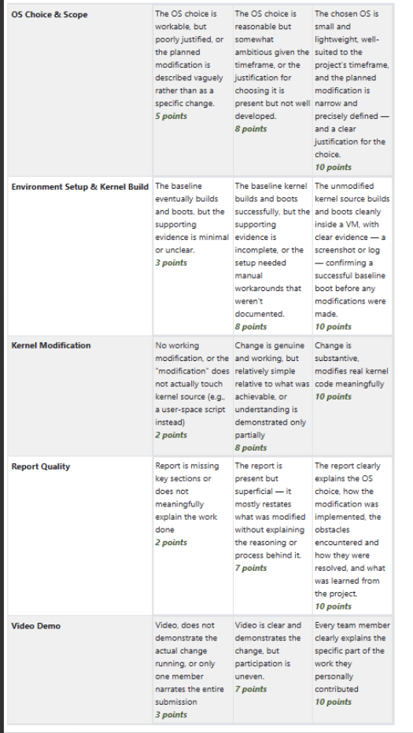

# Video Demo Script — xv6-VMM Demand Paging with Swap

> **Target length:** 8–12 minutes  
> **Recording tool:** OBS Studio (or any screen recorder with microphone)  
> **What to have open:** Terminal with xv6 project directory, a code editor (VS Code), QEMU ready to launch

---

## Rubric Alignment Checklist

Use this to ensure you hit every criterion for **10/10** in each category:



| Rubric Category | What the Video Must Show | Where in Script |
|---|---|---|
| **OS Choice & Scope (10 pts)** | "Small and lightweight, well-suited, narrow and precisely defined, clear justification" | Segment 1 |
| **Environment Setup & Kernel Build (10 pts)** | "Unmodified kernel boots cleanly inside a VM, screenshot or log confirming successful baseline boot" | Segment 2 |
| **Kernel Modification (10 pts)** | "Change is substantive, modifies real kernel code meaningfully" | Segments 3, 4, 5 |
| **Report Quality (10 pts)** | Covered by the written report (not the video) | — |
| **Video Demo (10 pts)** | "**Every team member** clearly explains the specific part of the work they **personally contributed**" | Segments 3, 4, 5 |

> [!CAUTION]
> The #1 mistake that costs points: **only one member narrates the entire video** (= 3 points). Each member MUST speak and explain their own code on camera/audio.

---

## Pre-Recording Checklist

- [ ] Each member has a working microphone
- [ ] Terminal font size is large enough to read on a 1080p recording (≥14pt)
- [ ] VS Code or editor has the relevant files open in tabs
- [ ] `git log` shows the clean baseline commit (`30b754a`) for the baseline demo
- [ ] The modified kernel is built and ready (`make qemu-nox` works)
- [ ] Decide recording approach:
  - **Option A (Best):** Record on one shared screen via Zoom/Discord screen share — each member takes control and speaks during their segment
  - **Option B:** Each member records their own segment, then stitch together in a video editor

---

## Segment 1 — Introduction & OS Choice (All Members)

**Duration:** ~1.5 minutes  
**Speaker:** Any one member (Mayur recommended as repo owner)  
**Screen:** Show the GitHub repo page, then the README.md

### Script:

> *[Show GitHub repo: github.com/MayurRajeshKeni/xv6-VMM]*
>
> **Mayur:** "Hi, we are Team xv6-VMM. Our members are Mayur Rajesh Keni, Hari-Prannav, and Nitin-YK.
>
> We chose **xv6** as our operating system. xv6 is a small, lightweight re-implementation of Unix V6 developed at MIT. The entire kernel is about 10,000 lines of C — small enough for us to fully understand, yet it has real hardware abstractions: x86 page tables, a PIO-based IDE disk driver, and a buffer cache.
>
> Most importantly, xv6 has **zero** swap or demand-paging support built in. So our modification is genuine — every line of swap code we wrote is new kernel code.
>
> Our project implements **demand paging with disk-backed swap**, split into three modules:"
>
> *[Show README.md on screen, point to the three team members]*
>
> "Module 1 — Disk & Swap Subsystem, owned by me, Mayur.  
> Module 2 — Page Fault Handler, owned by Hari-Prannav.  
> Module 3 — Eviction Policy & Memory Capping, owned by Nitin."

---

## Segment 2 — Baseline Kernel Boot (Any Member)

**Duration:** ~1.5 minutes  
**Speaker:** Any member  
**Screen:** Terminal — checkout baseline, build, boot in QEMU

### What to Record:

```bash
# Step 1: Show the clean baseline commit
git log --oneline

# Step 2: Checkout the baseline (BEFORE any modifications)
git stash   # or: git checkout 30b754a
make clean && make
make qemu-nox
```

### Script:

> *[Terminal: run `git log --oneline`, highlight commit `30b754a Initial commit: Clean xv6 baseline`]*
>
> **Speaker:** "Before we show our modifications, let's prove the **unmodified** xv6 kernel builds and boots cleanly.
>
> I'm checking out commit `30b754a`, the initial clean baseline."
>
> *[Run `make clean && make` — show it compiles with no errors]*
>
> "The kernel compiles successfully with no errors. Now let's boot it in QEMU."
>
> *[Run `make qemu-nox` — wait for the shell prompt]*
>
> "You can see: `xv6...`, `cpu0: starting 0`, `init: starting sh`, and the shell prompt. The baseline kernel boots perfectly. Let me run `ls` to show the unmodified file system."
>
> *[Type `ls` in the xv6 shell, show the file listing]*
>
> "Note that there is **no `swaptest` command** here — that's our addition. Let me switch back to our modified code."
>
> *[Ctrl+A then X to exit QEMU, then `git checkout main` or `git stash pop`]*

> [!IMPORTANT]
> **Do not skip this segment!** The rubric specifically says: *"screenshot or log confirming a successful baseline boot before any modifications were made"* for 10 points.

---

## Segment 3 — Disk & Swap Subsystem (Member 1: Mayur)

**Duration:** ~3 minutes  
**Speaker:** **Mayur** (must be Mayur speaking about his own work)  
**Screen:** Code editor showing `param.h`, `fs.h`, `ide.c`, then terminal for live demo

### What to Record:

#### Part A — Walk through the code (~2 min)

> *[Open `param.h` in editor, highlight `MAX_SWAP_PAGES`]*
>
> **Mayur:** "My job was to build the disk and swap subsystem — the low-level I/O layer that moves 4KB memory pages to and from the disk.
>
> First, I defined the swap space size. In `param.h`, `MAX_SWAP_PAGES` is set to 1024, meaning swap can hold up to 1024 pages — that's 4 megabytes of swap space."
>
> *[Switch to `fs.h`, highlight the swap boundary macros]*
>
> "In `fs.h`, I defined exactly where swap lives on disk. `SWAP_START` equals `FSSIZE`, which is block 1000. So the swap space starts right after the file system data, which means we never corrupt any existing file system blocks.
>
> Each 4KB page requires 8 disk sectors — that's `SECTORS_PER_PAGE`.
>
> I also defined `struct swap_entry` which tracks whether each slot is free or allocated, plus a `page_perm` field that stores the page table entry permission bits. This is important because when Member 3 evicts a page, we need to remember whether it was writable, user-accessible, etc., so Member 2 can restore those permissions when reading it back."
>
> *[Switch to `ide.c`, scroll to `swap_write` function (line ~269)]*
>
> "This is the core function: `swap_write`. It takes a pointer to a 4KB memory page and a swap slot number. The key is this loop —"
>
> *[Highlight the for-loop, lines 285–290]*
>
> "— it runs 8 times. Each iteration copies 512 bytes from the memory page into a disk buffer, sets the block number to the correct sector in the swap area, marks the buffer as dirty, and calls `iderw` to issue the actual IDE disk write. This translates one 4KB memory operation into 8 physical disk sector writes.
>
> `swap_read` does the exact reverse — 8 sector reads back into a memory page."
>
> *[Briefly show `defs.h` with the swap function prototypes]*
>
> "Finally, I exposed all these functions in `defs.h` so that Hari-Prannav's page fault handler and Nitin's eviction code can call them."

#### Part B — Live demo in QEMU (~1 min)

> *[Terminal: make sure modified kernel is built]*
>
> "Let me demonstrate this working live. I'll boot our modified kernel and run the `swaptest` command."
>
> *[Run `make qemu-nox`, wait for shell]*
> *[Type `swaptest` in the xv6 shell]*
>
> "The test allocates a swap slot, fills a 4KB page with a known pattern, writes it across 8 disk sectors, zeroes out the memory, reads it back from disk, and verifies every single byte matches. You can see: **PASSED** — the disk swap subsystem works correctly.
>
> Let me also verify the file system is unharmed —"
>
> *[Type `ls` in the xv6 shell]*
>
> "All the standard programs are still there. The swap space doesn't interfere with the file system at all."

---

## Segment 4 — Page Fault Handler (Member 2: Hari-Prannav)

**Duration:** ~2.5 minutes  
**Speaker:** **Hari-Prannav** (MUST be Hari-Prannav speaking)  
**Screen:** Code editor showing `trap.c` and `vm.c` changes, then terminal for demo

### Suggested Script Structure:

> **Hari-Prannav:** "My part was the page fault handler — the code that runs when a process tries to access a page that has been swapped out to disk.
>
> *[Show `trap.c`, highlight the T_PGFLT case]*
>
> When the CPU encounters a page fault — trap number 14 — it stores the faulting virtual address in the CR2 register. My code in `trap.c` catches this trap, reads CR2 to get the address, and then...
>
> *[Walk through the logic: check PTE, detect swapped-out marker, call swap_read, remap PTE]*
>
> ...calls Mayur's `swap_read` function to bring the page back from disk into a freshly allocated physical frame, then updates the page table entry to point to the new frame with the correct permissions.
>
> Let me show this working..."
>
> *[Demo: run a program that triggers a page fault on a swapped-out page, show it recovers]*

> [!TIP]
> If your page fault handler isn't fully integrated yet, at minimum show the code you wrote in `trap.c`, explain how it connects to the swap API, and demo whatever partial functionality works.

---

## Segment 5 — Eviction Policy & Memory Capping (Member 3: Nitin-YK)

**Duration:** ~2.5 minutes  
**Speaker:** **Nitin-YK** (MUST be Nitin speaking)  
**Screen:** Code editor showing `vm.c`, `proc.h`, and `kalloc.c` changes, then terminal for demo

### Suggested Script Structure:

> **Nitin:** "My part was the eviction policy — deciding which page to swap out when a process exceeds its physical memory limit.
>
> *[Show `proc.h`, highlight the per-process page tracking fields]*
>
> I added fields to track how many physical pages each process is using. When a process tries to allocate more pages than its cap...
>
> *[Show `vm.c`, highlight the eviction function]*
>
> ...my eviction function selects a victim page using [clock/FIFO/LRU algorithm]. It calls Mayur's `swap_write` to write the victim page to a swap slot on disk, then clears the PTE and frees the physical frame.
>
> *[Show the clock/FIFO/LRU selection logic]*
>
> Let me demonstrate..."
>
> *[Demo: allocate memory beyond the cap, show eviction messages, show the process still works because page faults bring data back]*

---

## Segment 6 — Conclusion (Any Member)

**Duration:** ~30 seconds  
**Speaker:** Any member

### Script:

> **Speaker:** "To summarize, we built a complete demand paging system for xv6:
> - Mayur built the disk swap subsystem that converts 4KB pages to 8 disk sectors.
> - Hari-Prannav built the page fault handler that transparently restores swapped-out pages.
> - Nitin built the eviction policy that selects which pages to swap out.
>
> The three modules work together as a closed loop. Thank you."

---

## Recording Tips for Maximum Points

### DO:
- ✅ **Each member speaks about their own code** — this is the single most important rubric requirement
- ✅ Show code on screen while explaining it — don't just talk
- ✅ Run a live demo in QEMU for each module
- ✅ Show the baseline boot BEFORE modifications
- ✅ Use `git log` to prove the commit history

### DON'T:
- ❌ Have one person narrate the whole thing (= 3/10 on Video Demo)
- ❌ Skip the baseline boot proof (= 3/10 on Environment Setup)
- ❌ Only show user-space code (= 2/10 on Kernel Modification)
- ❌ Read code line-by-line without explaining the design reasoning (= 7/10 on Report Quality)

---

## Timing Summary

| Segment | Speaker | Duration | Screen |
|---|---|---|---|
| 1. Intro & OS Choice | Mayur | 1.5 min | GitHub repo + README |
| 2. Baseline Boot | Any | 1.5 min | Terminal: `git checkout`, `make`, QEMU boot |
| 3. Disk & Swap | **Mayur** | 3 min | Editor: `param.h`, `fs.h`, `ide.c` → QEMU: `swaptest` |
| 4. Page Fault Handler | **Hari-Prannav** | 2.5 min | Editor: `trap.c`, `vm.c` → QEMU demo |
| 5. Eviction Policy | **Nitin-YK** | 2.5 min | Editor: `vm.c`, `proc.h` → QEMU demo |
| 6. Conclusion | Any | 0.5 min | — |
| **Total** | | **~11.5 min** | |
